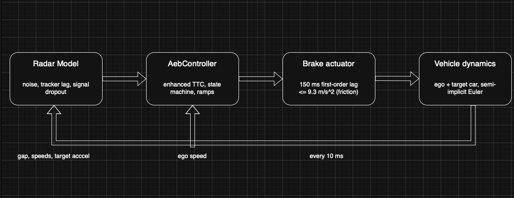
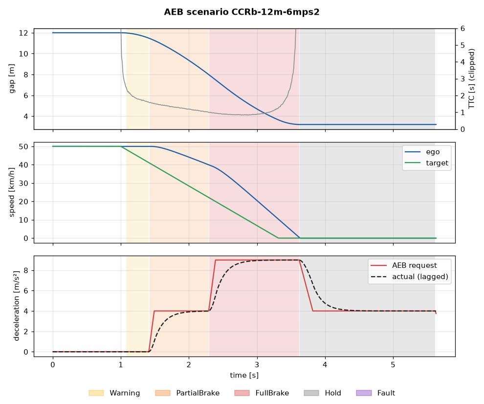
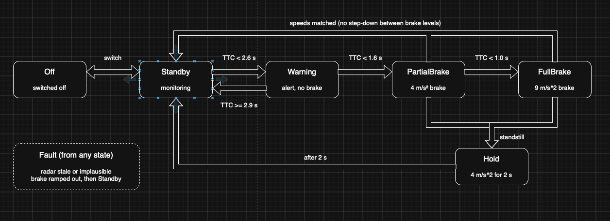

# Automatic Emergency Braking (AEB) – decision logic in embedded C++

An AEB decision function written from numbered requirements, unit-tested, checked in a
closed-loop vehicle simulation, and then run unchanged on a Cortex-M3. The microcontroller
is emulated by QEMU, so you don't need any hardware to run it.



| What | Where |
|---|---|
| Requirements with IDs + traceability | [docs/REQUIREMENTS.md](docs/REQUIREMENTS.md) |
| Controller (no heap, no exceptions, no STL) | [include/aeb/](include/aeb), [src/aeb_controller.cpp](src/aeb_controller.cpp) |
| Unit tests, named after requirement IDs | [tests/](tests) |
| Vehicle/radar simulator + Euro NCAP-style scenarios | [sim/](sim) |
| Bare-metal firmware (startup code, linker script, semihosting) | [target/](target) |

## Results

All 19 closed-loop scenarios pass, with identical results on the host (SIL) and on the
Cortex-M3 (PIL):

| Scenario (Euro NCAP naming) | Result |
|---|---|
| CCRs: stationary target, 10–50 km/h | collision avoided, stops 3–4 m short |
| CCRs: stationary target, 60 km/h | collision avoided, stops 1.6 m short |
| CCRs: stationary target, 70 km/h | impact at 15 km/h (speed reduced by 79 %) |
| CCRs: stationary target, 80 km/h | impact at 32 km/h (speed reduced by 60 %) |
| CCRm: target at 20 km/h, ego 30–70 km/h | collision avoided |
| CCRb: target brakes 2 or 6 m/s², 12 m or 40 m gap | collision avoided |
| Following / target pulling away | no warning, no braking |
| Driver kick-down (pedal at 100 %) | no warning, no braking: the driver override wins |
| Radar signal lost | fault lamp on, no braking (fail-silent) |



*Lead car brakes at 6 m/s² just 12 m ahead. Enhanced TTC warns 80 ms after it starts
braking, then the controller escalates through partial and full braking, stops 3.2 m
behind and holds the brake.*

## Bugs found by simulation (not by unit tests)

The unit tests passed from the start. Running the closed-loop scenarios found three real
design problems, and each one led to a requirement change, a code fix and a regression test:

1. **Coasting into stopped cars (CCRs-10…30).** The brake was released when TTC rose above
   the warning threshold. While slowing down towards a stopped car, TTC = distance / speed
   *grows*, so the car released the brake and rolled into the target at 1–2 km/h.
   → REQ-AEB-031: keep braking until speeds are matched.
2. **Braking lead car noticed too late (CCRb-12m-6mps2).** Constant-speed TTC is infinite when
   both cars drive at the same speed, even if the car in front is braking hard.
   → REQ-AEB-025: enhanced TTC that uses the object acceleration reported by the radar tracker.
3. **Release/hold race near standstill (seen in the plot).** Radar noise decided whether
   "speeds matched" (release) or "standstill" (hold) fired first.
   → REQ-AEB-031/040: near standstill, always brake to a stop and hold.

## Quick start

Install the tools (Ubuntu 24.04 is what CI uses):

```bash
sudo apt install cmake ninja-build libgtest-dev gcc-arm-none-eabi qemu-system-arm cppcheck
```

or on macOS:

```bash
brew install cmake ninja googletest arm-none-eabi-gcc arm-none-eabi-binutils qemu cppcheck
```

Then build and check everything:

```bash
python3 -m venv .venv && .venv/bin/pip install -r tools/requirements.txt   # only for plots
./tools/run_all.sh
```

Individual steps:

```bash
cmake --preset host && cmake --build --preset host
ctest --preset host                                # 67 unit + scenario tests
./build/host/aeb_sil --csv out                     # SIL run, CSV time series
.venv/bin/python tools/plot_scenarios.py out       # PNG per scenario

cmake --preset cortex-m3 && cmake --build --preset cortex-m3
cmake --build --preset cortex-m3 --target run      # run firmware in QEMU
./tools/compare_sil_pil.sh                         # host vs Cortex-M3 must match
./tools/static_analysis.sh                         # cppcheck
```

## Design notes

**State machine**



- **Debouncing:** escalation needs 2 consecutive cycles, so a single noisy radar frame cannot
  trigger braking. De-escalation uses 0.3 s TTC hysteresis.
- **Jerk limits:** brake request rises ≤ 50 m/s³ and falls ≤ 25 m/s³.
- **Fail-silent:** no radar frame for 200 ms, or NaN/Inf/out-of-range values, puts the
  function into `Fault`. It stops braking and turns on the fault lamp.

**Embedded constraints**

- The controller and simulator libraries include only `<stdint.h>`/`<stddef.h>`, with no heap
  and no `<cmath>` (`sqrt` is a fixed-iteration Newton method). The firmware build compiles
  them with `-ffreestanding -nostdlib -fno-exceptions -fno-rtti`. On the host, the same
  libraries are linked into a separate runner ([sim/host/main.cpp](sim/host/main.cpp)) that
  uses the normal C++ library to print results and write the CSV files.
- Firmware: 6.4 KB flash, 0 B static RAM (all state lives on the stack). The linker script
  limits it to a 256 KB / 64 KB budget, so it fails to link if it grows too big.
- Production code builds with `-Wall -Wextra -Wpedantic -Wconversion -Wsign-conversion
  -Wdouble-promotion -Wshadow -Werror`.
- SIL = PIL bit for bit: deterministic xorshift PRNG and no fused multiply-add on the host
  (`-ffp-contract=off`; clang on Apple Silicon fuses them by default). The Cortex-M3
  soft-float output therefore matches the host exactly, and `compare_sil_pil.sh` checks it.

**Startup without a C library ([target/startup.cpp](target/startup.cpp)):** a vector table at
address 0 and a reset handler that copies `.data`, zeroes `.bss` and runs static
constructors. The startup code is generic: the current firmware has no statics, so
`.data`, `.bss` and `.init_array` are all 0 bytes and those loops do nothing. They are there
so adding a global doesn't silently break. The firmware prints through ARM semihosting
(`BKPT 0xAB`) and reports pass/fail as the QEMU exit code.

## Limitations

- **Idealised radar model.** One in-path object, Gaussian noise and a first-order tracker
  lag. No clutter, ghost targets, multipath, lateral position or object classification,
  and no recorded sensor data.
- **Simple vehicle model.** Longitudinal point mass with a fixed friction limit (dry
  asphalt) and a first-order brake lag. No pitch, load transfer, slope or wet road.
- **Not developed to ISO 26262.** No hazard analysis or ASIL, no safety goals, no MC/DC
  coverage, no MISRA check. The requirements are written in that style but not derived
  from a safety analysis.
- **No timing analysis.** The firmware runs the scenarios as fast as it can instead of in a
  10 ms interrupt, and QEMU is not cycle-accurate, so there is no worst-case execution
  time yet.
- **Scenario coverage.** Car-to-car rear scenarios only; no pedestrians, cyclists, turning
  or crossing traffic.

## Possible extensions

- Run the control loop from a SysTick interrupt and measure worst-case execution time.
- Add a CAN interface: decode radar and vehicle-speed frames from a DBC-like definition.
- Pedestrian/cyclist targets (Euro NCAP VRU), or radar + camera fusion with a Kalman filter.
- Coverage report (`gcov`/`llvm-cov`) and MISRA C++:2023 checks.

## License

MIT, see [LICENSE](LICENSE).
